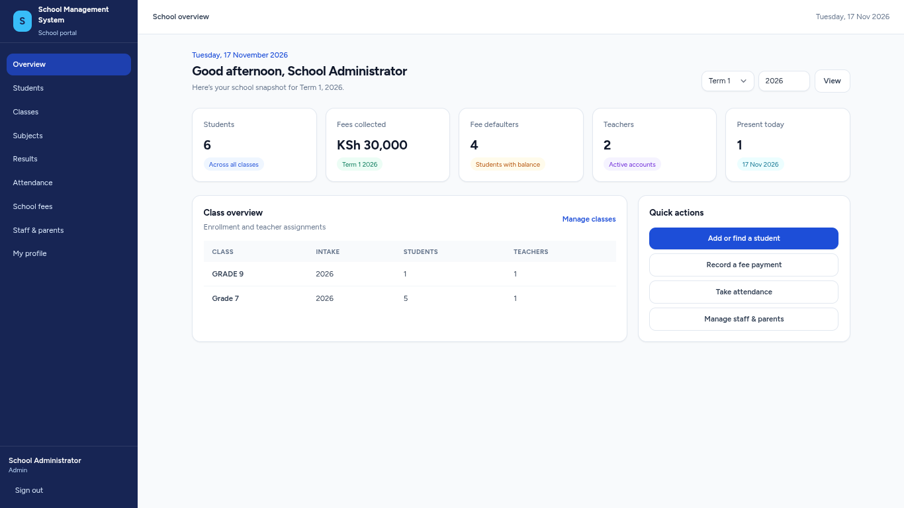

# School Management System



A lightweight student, fee, assessment, and attendance portal for small schools and colleges in Kenya.

## Stack

- Laravel 12, PHP 8.2+, MySQL
- Blade, Tailwind CSS, Alpine.js, Laravel Breeze
- DomPDF for fee receipts and report cards

Laravel 11 could not be installed because Composer's security policy blocks its currently published releases. This project uses the supported Laravel 12 release rather than disabling dependency security checks.

## Local setup

1. Install PHP 8.2+, Composer, Node.js, and MySQL. Create a database named `school_management`.
2. Install PHP and frontend packages:

   ```sh
   composer install
   npm install
   ```

3. Configure the environment and app key:

   ```sh
   cp .env.example .env
   php artisan key:generate
   ```

   Set `DB_DATABASE`, `DB_USERNAME`, and `DB_PASSWORD` for your MySQL server. Set `SCHOOL_NAME` to the school's name.

4. Create tables and the sample school:

   ```sh
   php artisan migrate --seed
   npm run build
   php artisan serve
   ```

   Open `http://127.0.0.1:8000`.

## Demo accounts

The database seeder creates an administrator, teacher, parent, and five student accounts. All seeded accounts use `password`.

| Role | Email |
|---|---|
| Admin | `admin@school.test` |
| Teacher | `teacher@school.test` |
| Parent | `parent@school.test` |
| Student | `student1@school.test` through `student5@school.test` |

Change seeded passwords and demo data before deploying. Public registration creates student-role accounts only; an administrator links a student account to its student record. A parent account sees records whose parent phone matches the phone on the account.

## Features

- Role-protected dashboards for administrators, teachers, students, and parents.
- Class and teacher assignments, student enrollment, search, staff and parent accounts, and class subjects.
- Term/year fee structures, payment recording, balance/defaulter tracking, and downloadable PDF receipts.
- Subject mark entry with automatic A–E grade calculation, class positions, and downloadable report cards.
- Daily attendance with present/absent/late statuses, class summaries, and attendance percentages.
- Parent SMS messages are logged locally for later Africa's Talking integration in `storage/logs/laravel.log`.
- Responsive blue-and-white sidebar layout, including small-screen navigation.

## Notes

- Terms are `Term 1`, `Term 2`, and `Term 3`; each fee structure, payment, and result is recorded against an academic year.
- M-Pesa codes are required for M-Pesa payments and unique where supplied. Payments cannot exceed the remaining term balance.
- Only administrators can create accounts with administrative privileges or record payments. Teachers can enter marks and attendance only for assigned classes.
